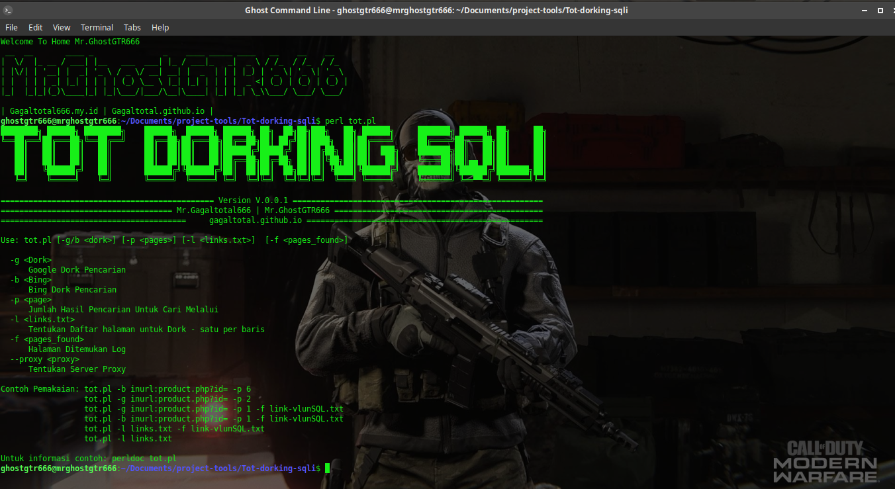
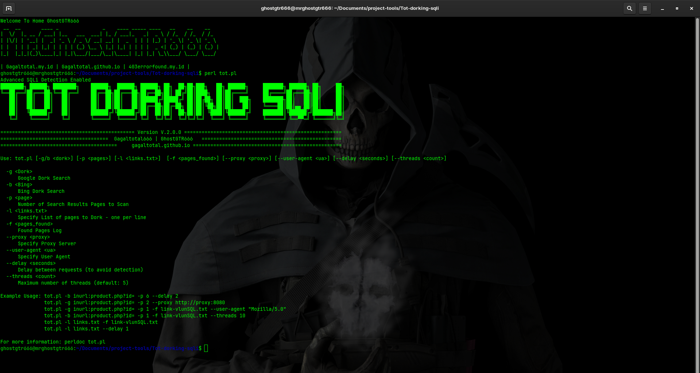

# Tot-dorking-sqli
#### Version 2.0.0 ####
#### Gagaltotal.github.io ####
#### Gagaltotal666 | GhostGTR666 ####

### installation package use Perl ####

#installation package Debian,Ubuntu, Mint, Kali, Parrot, BackBox:

```sh
sudo apt install perl
```

#installation package ARCH, Black ARCH, Manjaro:

```sh
sudo pacman -Sy perl
```



## Use Tot-Dorking-SQLi

```sh
- perl tot.pl -b inurl:product.php?id= -p 6
- perl tot.pl -g inurl:product.php?id= -p 2
- perl tot.pl -g inurl:product.php?id= -p 1 -f link-vlunSQL.txt
- perl tot.pl -b inurl:product.php?id= -p 1 -f link-vlunSQL.txt
- perl tot.pl -l links.txt -f link-vlunSQL.txt
- perl tot.pl -l links.txt
```

## Perubahan versi 2.0.0 :



1. Enhanced SQLi Detection:

- Menambahkan multiple SQLi payloads untuk berbagai jenis database
- Mendeteksi error-based, time-based, dan boolean-based SQLi
- Support untuk MySQL, Oracle, SQL Server, dan lainnya
- Improved Search Capabilities:
- Pattern matching yang lebih baik untuk hasil pencarian
- Support untuk berbagai jenis parameter (PHP, ASP, JSP)
- Penanganan URL encoding yang lebih baik

2. Anti-Detection Features:

- Delay antara requests untuk menghindari blokir
- Rotasi user agent secara acak
- Support proxy dengan authentication

3. Threading System:

- Multi-threading untuk scanning yang lebih cepat
- Kontrol jumlah thread maksimal

4. Enhanced Output:

- Warna dan formatting yang lebih baik
- Klasifikasi jenis SQLi yang ditemukan
- Informasi yang lebih detail tentang vulnerability

5. Additional Options:

- Parameter tambahan untuk user agent custom
- Delay configurable antara requests
- Control jumlah thread